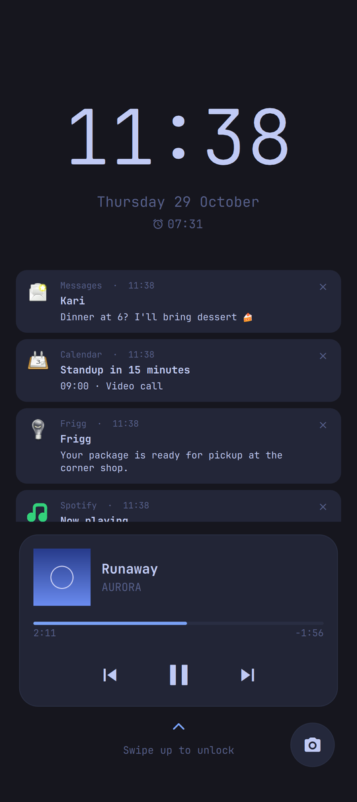
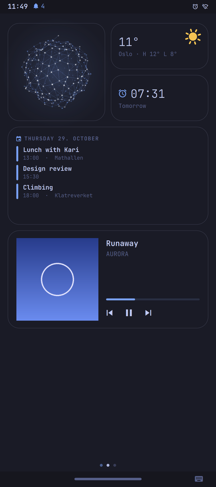
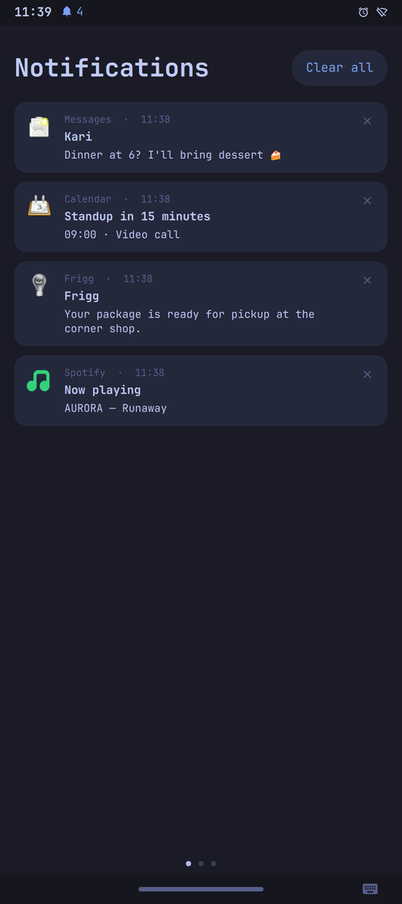
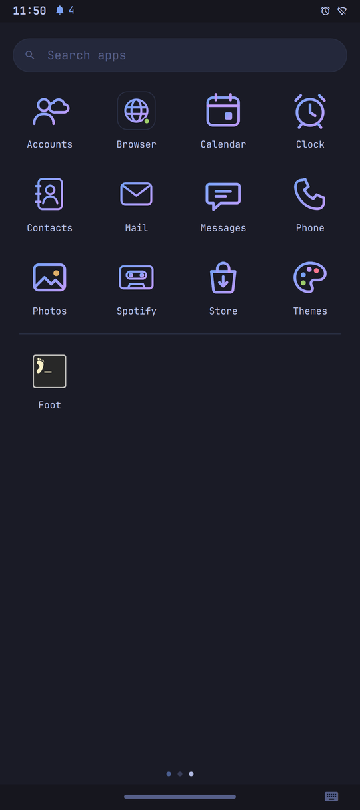
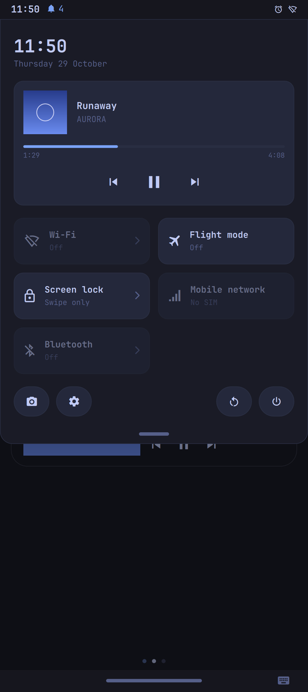
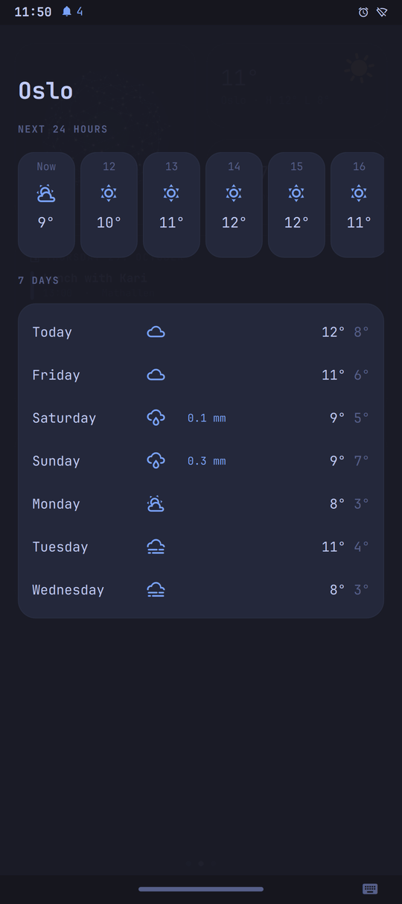
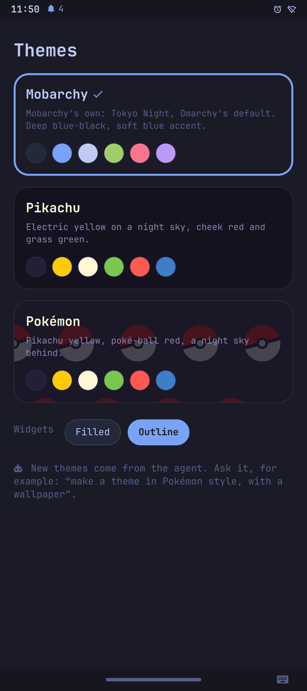

<div align="center">

# Mobarchy

**An AI-first mobile Linux OS.**<br>
The whole phone is exposed to AI agents as tools (MCP), so an agent can see and do
everything you can do on it: and you can just ask.

Arch Linux · Hyprland · Qt Quick · inspired by [Omarchy](https://omarchy.org)

[Features](#features) · [Apps](#apps) · [Supported phones](#supported-phones) · [Quick start](#quick-start-simulator) · [Docs](#documentation) · [License](#license)

</div>

> **Status:** early development, in daily use on a Pixel 9 Pro Fold. Expect rough edges,
> and use a phone you are willing to experiment on.

| | | | |
|:-:|:-:|:-:|:-:|
|  |  |  |  |
| Boot | Lock screen | Home | Notifications |
|  |  |  |  |
| Apps | Quick settings | Weather | Themes |

<sub>Screenshots from the simulator, with made-up data; the boot screen is the splash as the phone draws it.</sub>

## Features

### 🤖 AI-first
- **The phone as tools.** 85 MCP tools: the screen (look, tap, type), apps, calls and
  messages, mail, calendar, contacts, alarms, settings, themes, widgets and more.
- **Safe by design.** Every tool has a risk level. Risky steps (a call, a message, a
  deletion) and root are approved by you on the screen, with your finger or PIN.
- **Frigg**, the phone's assistant. Say "Hei Frigg" for a live voice conversation (it knows
  your voice), or type. Frigg runs on your own Claude or OpenAI account, a local model on
  the phone, or an API key.
- **Made for you, by the agent.** Ask for a theme ("Pokémon style, with a wallpaper") or a
  widget ("the news, only on the big screen"): the agent writes a description, and the
  shell draws it. No generated code runs on your phone.

### 📱 The shell
- **Home as pages:** notifications, a board of widgets you arrange, and the apps.
- **Lock screen** with your PIN (it is your password) and the fingerprint sensor.
- **Its own on-screen keyboard** with emoji search, and hardware keyboards with shortcuts
  (⌘+Tab, ⌘+Space for emoji, ...).
- **Foldables:** the screen follows the fold and turns with the device, animated (a
  Hyprland plugin of Mobarchy's own); half open, the phone becomes a laptop.
- **Themes** for the whole system: colours, fonts, wallpapers, filled or outlined cards.

### 🛠 Under the hood
- **Arch Linux ARM** with the vendor's kernel built from source, and the vendor's own
  hardware services (modem, camera, fingerprint) in a small Android container.
- **A curated app store** on top of Arch, and web apps on the home screen.
- **A QEMU simulator** that behaves as a device, driven through the same MCP tools.
- **Ports are thin:** everything device-specific lives in `devices/<codename>/`.

## Apps

| | App | |
|:-:|---|---|
| 📞 | **Phone & Messages** | Calls and SMS through the phone's own modem, with contacts and history |
| 👥 | **Contacts** | Your iCloud, Google and CardDAV contacts, kept on the phone |
| 📅 | **Calendar** | The phone's own calendar and your accounts' (CalDAV), as one |
| ✉️ | **Mail** | After Spark: people, notifications and newsletters apart; swipe to archive or snooze |
| ⏰ | **Clock** | Alarms and timers that ring even when the phone sleeps |
| 📷 | **Camera & Photos** | Both cameras through the vendor's camera stack |
| 🌐 | **Bifrost** | The browser: DRM video, 1Password, tabs as pictures, web apps on the home screen |
| 🎵 | **Spotify** | Your playlists, liked songs and albums, played as a cassette deck; a Spotify Connect device too |
| 🛍️ | **Store** | Apps known to work on Mobarchy, native and web |
| 🎨 | **Themes** | Mobarchy's themes and the ones the agent made for you |
| 🔑 | **Accounts** | Google, iCloud, Nextcloud and other accounts, for contacts, calendars and mail |
| ✨ | **Frigg** | The assistant, by voice or text, over everything |

And any Linux app that runs on Wayland (a terminal, Chromium, ...). Android apps through
Waydroid are an experiment, parked for now.

## Supported phones

| Phone | Codename | Status |
|---|---|---|
| Google Pixel 9 Pro Fold | [`comet`](devices/comet/) | 🟢 Daily driver (with rough edges) |
| *Simulator (QEMU/KVM, x86_64)* | [`sim-x86_64`](devices/sim-x86_64/) | 🟢 For development |

Want to bring Mobarchy to another phone? See [devices/README.md](devices/README.md).

### Google Pixel 9 Pro Fold (`comet`)

✅ works · 🟡 works, with limits · ❌ not yet

| | Feature | Notes |
|:-:|---|---|
| ✅ | Boot, kernel | Our own build of Google's kernel; Arch Linux ARM on the userdata partition |
| ✅ | Displays | Both panels; rotation and fold animated |
| ✅ | Touch | Both screens; tap to wake |
| ✅ | GPU | Mali-G715 on Panthor (backported) and Mesa |
| ✅ | Fold sensor, laptop mode | The phone follows the fold; half open, a laptop |
| ✅ | Calls and SMS | In and out, with call audio; through oFono and the vendor's radio stack |
| 🟡 | In-call microphone, VoLTE | Not verified yet |
| ✅ | Mobile data | LTE (tested on Telenor) |
| 🟡 | Wi-Fi | Works; resuming from deep sleep can hang it, and a watchdog recovers it |
| ✅ | Wi-Fi hotspot | |
| 🟡 | Bluetooth | Works (audio, keyboards, calls); the chip's low-power mode not yet |
| ✅ | Audio | Speakers, earpiece, Bluetooth headsets |
| ✅ | Haptics | |
| ✅ | Cameras | Both, with preview and photos |
| ✅ | Fingerprint | Unlock and approvals, through the TEE |
| ✅ | GNSS (location) | Through GeoClue |
| ✅ | Sensors, rotation | Accelerometer, light, proximity, hinge angle |
| ✅ | Battery, charging, thermal | Pixel's thermal service keeps charging cool |
| 🟡 | Deep sleep | Wakes for alarms; calls while asleep not verified yet |
| ❌ | NFC, tap to pay | Not on the phone; see ADR 0030 |
| ❌ | Installer | Flashing is manual for now (see [devices/comet](devices/comet/)) |

## Layout

```
agent/     Agent runtime and the OS tool layer (MCP servers). This is Mobarchy's core.
os/        Generic userspace. Device-agnostic. config/ = session config, rootfs/ = system files,
           initramfs/ = debug init for first boots, kernel/ = kernel config fragment,
           image/ = device rootfs image builder (Arch Linux ARM).
devices/   One directory per device (boot, kernel, hardware adaptation). Kept thin.
sim/       The simulator: a QEMU/KVM VM that acts as a device, plus tools to drive it.
tools/     Containerized helpers: Android image unpacking, kernel builds.
docs/      Brief, architecture, and decision records (docs/decisions/).
```

The key rule: **nothing outside `devices/` may assume a specific phone.** See [devices/README.md](devices/README.md).

## Quick start (simulator)

Requirements: Linux host with KVM, `qemu-system-x86_64`, OVMF, `xorriso`, Python 3.11+.

```sh
sim/mobsim create      # download base image, build disk + cloud-init seed
sim/mobsim up          # boot, wait for the shell (first boot provisions, ~5 min), deploy the tree

# On the phone: tap Frigg on the home screen and ask (it needs an agent signed in: see agent/mobarchy-agent).

# Drive the phone through its MCP server, like an agent would:
cd agent/mobarchy-mcp
uv run mobarchy-mcp-call tools
uv run mobarchy-mcp-call call screenshot --image-out shot.png
uv run mobarchy-mcp-call call tap '{"x": 225, "y": 500}'
```

See [sim/README.md](sim/README.md) for all commands.

## Documentation

- [Project brief](docs/brief.md)
- [Architecture](docs/architecture.md)
- [Decision records](docs/decisions/)
- [Research notes](docs/research/)

## License

Mobarchy is free software: you can redistribute it and/or modify it under the terms of the
GNU General Public License as published by the Free Software Foundation, either version 3 of
the License, or (at your option) any later version ([GPL-3.0-or-later](LICENSE)).

Some parts keep the licenses of the projects they come from or change:
- the kernel patches (`devices/*/kernel/`): GPL-2.0, as the Linux kernel;
- the patches and build files for other projects' packages (`os/packages/`): those projects'
  licenses (the packages for proprietary software, 1Password and Widevine, contain only the
  build files that fetch it);
- the Caveat font (`os/shell/data/fonts/`): SIL Open Font License 1.1;
- the emoji data (`os/shell/data/emoji.json`): the Unicode License.
